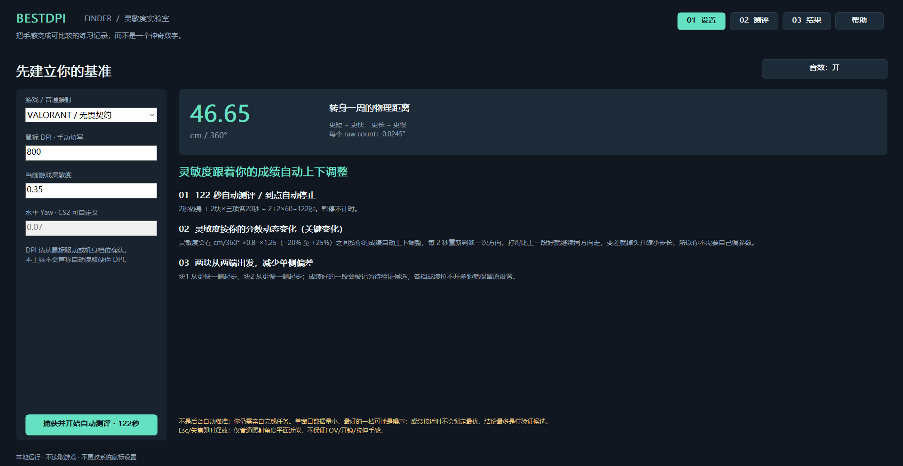

<p align="center"></p>
<h1 align="center">BestDPI Finder</h1>
<p align="center"><strong>让成绩，帮你选择下一档灵敏度。</strong><br>Windows 上的 FPS 灵敏度实验室 · 120 秒测评 + 2 秒热身</p>
<p align="center"><a href="https://github.com/ZJBIG/BestDPIFinder/releases/latest">下载 Windows 免安装版</a> · <a href="https://zjbig.github.io/BestDPIFinder/">项目主页</a> · <a href="#如何使用">快速开始</a> · <a href="#原理与边界">原理与边界</a></p>
<p align="center"></p>



你知道自己的 DPI，却不确定游戏灵敏度该往哪调？BestDPI Finder 从当前设置出发，在定位点击、小目标微调和连续跟踪三项任务中，根据每个计分窗口的表现调整测试场灵敏度，整理出值得回到真实游戏复核的候选。

> **一次测评，一份清晰的调参记录。** 分数接近或数据不足时，程序会建议保留原设置。

## 下载

| 下载内容 | 适合谁 |
| --- | --- |
| [Windows x64 免安装 ZIP](https://github.com/ZJBIG/BestDPIFinder/releases/latest/download/BestDPIFinder-Windows-x64.zip) | 推荐：解压后双击 EXE，无需安装 Python |
| [发布说明与 SHA-256](https://github.com/ZJBIG/BestDPIFinder/releases/latest) | 查看版本变化、文件校验和演示视频 |
| [源代码](https://github.com/ZJBIG/BestDPIFinder/archive/refs/heads/main.zip) | 阅读实现或自行构建 |

支持 Windows 10/11 x64。请解压到可写文件夹。EXE 尚未签名；遇到安全提示时请核对来源与校验值，勿关闭系统安全防护。

## 为什么试试它

- **从你现在的设置出发。** 手动输入真实硬件 DPI 与游戏灵敏度，支持 VALORANT / 无畏契约、CS2 普通腰射换算。
- **只管完成任务。** 每 2 秒结算一次成绩，窗口内灵敏度不变；成绩改善时继续探索，变差时掉头并缩小步长。
- **三个维度，一次记录。** 定位、微调、跟踪各 20 秒，两块测评分别从快侧和慢侧起步。
- **知道何时停止下结论。** 原始窗口数据与推荐理由保存在本地，可导出 JSON；低分、平坦曲线和单次峰值不会被包装成最优答案。

## 如何使用

1. 解压下载包，运行 `BestDPIFinder.exe`，选择游戏并填写鼠标 DPI、当前游戏灵敏度。
2. 点击开始。2 秒热身后完成两块测评，每块依次进行定位点击、微调、跟踪；有效测评时间为 120 秒。
3. 查看成绩轨迹与候选值，导出记录，再到真实游戏中手动填写候选数值并复核手感。

`Esc` 或切换窗口会释放鼠标；恢复需要主动点击，暂停不计时，中断块需要重试。软件只改变自身测试场的灵敏度，不修改系统鼠标设置或硬件 DPI，不连接或控制游戏。

## 演示

[观看演示视频](https://github.com/ZJBIG/BestDPIFinder/releases/latest/download/BestDPIFinder-demo.mp4) · [网页内播放](https://zjbig.github.io/BestDPIFinder/#demo)

演示使用真实程序截图与正常计时采集的 QA 模拟输入片段，展示设置、任务和使用说明。

## 原理与边界

预算为 `2 秒热身 + 2 × 3 × 20 秒任务 = 122 秒`。程序每 2 秒按成绩反馈进行启发式爬山，两块从相反方向出发。`cm/360° = 914.4 / (DPI × sensitivity × yaw)`。

这是一套短时启发式搜索：候选需要在真实游戏里复核。普通腰射角度换算不复刻 FOV、开镜、拉伸和后坐力；默认 yaw 来自第三方资料。

每块记录自动写入程序旁 `results/adaptive-latest.json`；再次测评会更新该文件，需要保留历史时请主动导出。测评不后台上传。当前结果 schema 为 6，旧 schema 2–5 明确拒收，请重新测评。

## 从源码运行与构建

普通运行只需要 Windows 和 Python 3.10+ 的标准库。当前打包与测试使用 Python 3.13。

```powershell
python main.py
python -m unittest discover -s tests -q

# 独立构建环境；PyInstaller 只用于生成 EXE
python -m venv .venv-build
.\.venv-build\Scripts\python.exe -m pip install PyInstaller
.\.venv-build\Scripts\python.exe build.py
```

EXE 输出到 `outputs/BestDPIFinder.exe`。QA 自动运行另需 `requirements-autotest.txt`，可通过 `setup_autotest.ps1` 和 `run_autotest.ps1` 使用；`--autotest-fast` 仅限开发验证，不能用于正式演示素材。

## 反馈

请在 [Issues](https://github.com/ZJBIG/BestDPIFinder/issues) 附上 Windows 版本、显示缩放、鼠标回报率和复现步骤；公开分享结果文件前请自行检查其中的个人备注。
